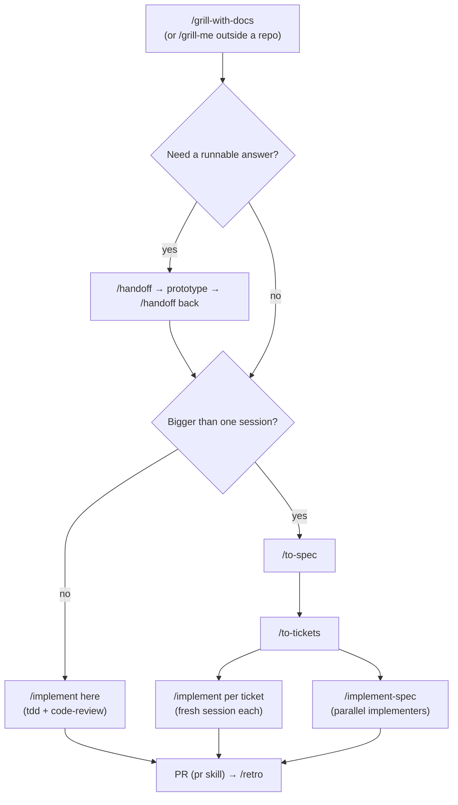

# Skills For Real Engineers

Agent skills for OpenCode v2, for real engineering - not vibe coding.

Developing real applications is hard. Approaches like GSD, BMAD, and Spec-Kit try to help by owning the process. But while doing so, they take away your control and make bugs in the process hard to resolve.

These skills are designed to be small, easy to adapt, and composable. They work with any model OpenCode can talk to. Hack around with them. Make them your own.

**Contents:** [Install](#install) · [Using skills in OpenCode](#using-skills-in-opencode) · [Recommended flow](#recommended-flow) · [Why these skills exist](#why-these-skills-exist) · [Reference](#reference)

## Install

You need OpenCode v2 (tested on 2.3.2) and git. The issue-tracker skills also use `gh` or `glab` if you pick GitHub or GitLab.

### 1. Add the plugin

Add the plugin to `opencode.jsonc` (project) or `~/.config/opencode/opencode.jsonc` (all projects):

```jsonc
{
  "$schema": "https://opencode.ai/config.json",
  "plugins": [
    { "package": "github:sadman-bk/opencode-skills#main", "options": {} }
  ]
}
```

OpenCode reloads config without a restart. Then run `/setup-skills` once per repo.

The plugin registers every skill, a slash command for each one, and an `@skill-id` mention. A branch ref (`#main`) is checked for updates at startup and every 24 hours, so the plugin updates itself. Pin a tag (`#v2.0.0`) to stop that, and run `opencode plugin update` to force a check.

| Option | Default | What it does |
| --- | --- | --- |
| `buckets` | `["engineering", "productivity"]` | Skill folders to load. Add `"in-progress"` or `"misc"` (for example `git-guardrails`) to opt in to skills that aren't promoted. |
| `commands` | `"all"` | `"user-invoked"` registers slash commands only for the hidden skills; `"none"` registers none. |
| `exclude` | `[]` | Skill IDs to skip, for example one you already have in `~/.config/opencode/skills/` (a skill you install yourself shadows the plugin's). |

See [.agents/install-block.md](./.agents/install-block.md) for a local checkout and name collisions.

### 2. Run `/setup-skills` in each repo

It will:

- Ask you which issue tracker you want to use (GitHub, GitLab, local files, or anything else you describe)
- Ask you what labels you apply to tickets when you triage them (`/triage` uses labels)
- Ask you where you want to save any docs we create
- Offer to copy the four subagents below into `.opencode/agents/` (or `~/.config/opencode/agents/`). A plugin can't register agents, so this step is a copy.

**Commit `.opencode/agents/`.** `/implement-spec` runs each implementer in its own git worktree, and a worktree only contains tracked files, so an uncommitted agent is "not found" there.

### 3. Check it worked

Type `/` in the TUI: you should see `/ask-skills`, `/grill-with-docs`, `/tdd` and the rest. Run `/agents` to see `implementer`, `merger`, `researcher` and `code-reviewer`.

## Using skills in OpenCode

### Three ways a skill runs

| How | Example | When |
| --- | --- | --- |
| **Slash command** | `/to-tickets .scratch/auth/spec.md` | You want a skill now. Text after the command is passed to it. Also in the **Ctrl+P** command palette. |
| **Mention** | `Fix the login redirect, @tdd` | You want a skill pulled into a normal prompt. |
| **Model-invoked** | "this test is flaky, find out why" loads `diagnosing-bugs` | The agent loads it when the task fits. Only model-invoked skills are listed for the agent. |

**User-invoked** skills (`/grill-with-docs`, `/to-spec`, `/implement`...) orchestrate a whole phase, so they stay hidden from the model and only start when you type them. **Model-invoked** skills (`tdd`, `code-review`, `diagnosing-bugs`...) hold reusable discipline, so the agent may reach for them on its own. The [Reference](#reference) lists which is which.

Not sure which one fits? Run **`/ask-skills`** and describe your situation. It's a router over every skill here.

### Agents

Use the built-in **`build`** agent (the default) for every flow: the skills write files such as `GLOSSARY.md`, specs and tickets. Switch with **Shift+Tab** or `/agents`. The read-only **`plan`** agent only suits `/grill-me`, which saves nothing.

`/setup-skills` installs four subagents. Each starts with a fresh context and can't `git push`:

| Subagent | Started by | Job |
| --- | --- | --- |
| `implementer` | `/implement-spec` | Builds one ticket in its own git worktree, test-first. |
| `merger` | `/implement-spec` | Merges finished ticket branches into the integration branch. |
| `researcher` | `research`, `/wayfinder` | Reads primary sources and writes a cited note. |
| `code-reviewer` | `code-review` | Reviews a diff on one axis (Standards or Spec). Doesn't edit files. |

Subagents run in the background, so keep working while they do. OpenCode lets subagents nest one level deep by default (`experimental.subagent_depth: 1`). The skills are written for that, so leave it as it is.

### Session moves you'll use

| Move | In OpenCode |
| --- | --- |
| Fresh session | **Ctrl+X N**. Old sessions stay in `/sessions` (**Ctrl+X L**). |
| Parallel work | Tabs: **Ctrl+Tab** to switch, one session per tab. |
| Shrink a long session | Automatic compaction (`compaction.auto`). To do it at a phase boundary: `opencode api post /api/session/<id>/compact --data '{}'`. |
| Undo a bad turn | `/undo` (it also reverts the file edits). |
| Hand work to another model, directory or person | `/handoff`, then start a new session on the file. |
| Headless run | `opencode run "/implement 42"`. Add `--worktree` to run it in a new git worktree. |

### Optional: git guardrails

Add `"misc"` to `buckets` and run `/git-guardrails`. It writes OpenCode `shell` permission rules that block `git push`, `git reset --hard`, `git clean -f`, `git branch -D` and similar commands, project-wide or globally.

## Recommended flow

Most work travels one **main flow**, from idea to shipped code:



1. **Sharpen the idea:** `/grill-with-docs`. It interviews you one round at a time, asking pick-one questions through OpenCode's question picker. It records the terms it settles in `GLOSSARY.md` and the decisions in ADRs, so later sessions start with the shared language. Outside a repo, use `/grill-me`.
2. **Prove the risky part (optional):** if a question needs running code to settle, run `/handoff`, open a new session, prototype it (`@prototype`), then `/handoff` the answer back.
3. **Plan, if it's bigger than one session:** run `/to-spec` and then `/to-tickets`. **Keep steps 1 to 3 in one session.** The spec and tickets are better when the grilling is still in context, so don't start a new session until the tickets exist.
4. **Build.** Pick one:
   - **Small:** `/implement` in the same session.
   - **Ticket by ticket:** a fresh session (**Ctrl+X N**) for each ticket, then `/implement <ticket>`. Each ticket carries its own context.
   - **Whole spec at once:** `/implement-spec`. It runs `implementer` subagents in parallel, one per ready ticket, each in its own worktree. The results land on one integration branch, and `code-review` runs over that branch.

   Either way the code is built test-first with `tdd`, and a two-axis `code-review` (Standards and Spec) closes it out.
5. **Ship and learn:** the agent shapes the PR body with the `pr` skill. Then run `/retro` **in the same session**. It turns what went wrong into checks, coding standards or steering-file fixes, so the next build starts from a better environment.

### Where else to start

| Situation | Start with | Then |
| --- | --- | --- |
| A pile of incoming bugs and requests | `/triage` | `/implement` each agent-ready issue |
| A hard bug, flake or regression | `@diagnosing-bugs` | `/retro` in the same session |
| A huge, foggy effort (new product, big rewrite) | `/wayfinder` | `/to-spec` once the map is clear, then step 3 |
| Spare time, codebase feels muddy | `/improve-codebase-architecture` | Pick a candidate and run `/grill-with-docs` on it |
| You need someone else's answer | `/to-questionnaire` | Feed the answers into `/grill-with-docs` or `/to-spec` |
| Reading legwork | `@research` | Keep working; take the cited note into the grilling |
| A step only a human can do (secrets, dashboards) | `@wizard` | Run the generated script |
| A reply you didn't follow | `/wait-what` | Carry on |

### At a phase boundary

When one phase ends (the grilling is done, the tickets exist, the build is merged), ask these in order and stop at the first yes:

1. Does the next phase need this one verbatim, and does it still fit? **Continue.**
2. Is this context useless for what's next? **New session** (Ctrl+X N).
3. Is the work moving to another model, directory or person? **`/handoff`**.
4. Can it run unattended? Hand it to a **subagent**.
5. Otherwise, **compact** and carry on.

[PHASE-BOUNDARIES.md](./skills/engineering/ask-skills/PHASE-BOUNDARIES.md) explains the reasoning behind each question.

## Why These Skills Exist

These skills fix common failure modes of coding agents.

### #1: The Agent Didn't Do What I Want

> "No-one knows exactly what they want"
>
> David Thomas & Andrew Hunt, [The Pragmatic Programmer](https://www.amazon.co.uk/Pragmatic-Programmer-Anniversary-Journey-Mastery/dp/B0833F1T3V)

**The Problem**. The most common failure mode in software development is misalignment. You think the dev knows what you want. Then you see what they've built - and you realize it didn't understand you at all.

This is just the same in the AI age. There is a communication gap between you and the agent. The fix for this is a **grilling session** - getting the agent to ask you detailed questions about what you're building.

**The Fix** is to use:

- [`/grill-me`](./skills/productivity/grill-me/SKILL.md) - for non-code uses
- [`/grill-with-docs`](./skills/engineering/grill-with-docs/SKILL.md) - same as [`/grill-me`](./skills/productivity/grill-me/SKILL.md), but adds more goodies (see below)

These are the most used skills here. They help you align with the agent before you get started, and think deeply about the change you're making. Use them _every_ time you want to make a change.

### #2: The Agent Is Way Too Verbose

> With a ubiquitous language, conversations among developers and expressions of the code are all derived from the same domain model.
>
> Eric Evans, [Domain-Driven-Design](https://www.amazon.co.uk/Domain-Driven-Design-Tackling-Complexity-Software/dp/0321125215)

**The Problem**: At the start of a project, devs and the people they're building the software for (the domain experts) are usually speaking different languages.

Agents feel the same tension. They are usually dropped into a project and asked to figure out the jargon as they go. So they use 20 words where 1 will do.

**The Fix** for this is a shared language. It's a document that helps agents decode the jargon used in the project.

<details>
<summary>
Example
</summary>

Here's the effect of a glossary on how a problem is described. Which one is easier to read?

- **BEFORE**: "There's a problem when a lesson inside a section of a course is made 'real' (i.e. given a spot in the file system)"
- **AFTER**: "There's a problem with the materialization cascade"

This concision pays off session after session.

</details>

This is built into [`/grill-with-docs`](./skills/engineering/grill-with-docs/SKILL.md). It's a grilling session, but that helps you build a shared language with the AI, and document hard-to-explain decisions in ADR's.

It's hard to explain how powerful this is. It might be the single coolest technique in this repo. Try it, and see.

> [!TIP]
> A shared language has many other benefits than reducing verbosity:
>
> - **Variables, functions and files are named consistently**, using the shared language
> - As a result, the **codebase is easier to navigate** for the agent
> - The agent also **spends fewer tokens on thinking**, because it has access to a more concise language

### #3: The Code Doesn't Work

> "Always take small, deliberate steps. The rate of feedback is your speed limit. Never take on a task that’s too big."
>
> David Thomas & Andrew Hunt, [The Pragmatic Programmer](https://www.amazon.co.uk/Pragmatic-Programmer-Anniversary-Journey-Mastery/dp/B0833F1T3V)

**The Problem**: Let's say that you and the agent are aligned on what to build. What happens when the agent _still_ produces crap?

It's time to look at your feedback loops. Without feedback on how the code it produces actually runs, the agent will be flying blind.

**The Fix**: You need the usual tranche of feedback loops: static types, browser access, and automated tests.

For automated tests, a red-green-refactor loop is critical. This is where the agent writes a failing test first, then fixes the test. This helps give the agent a consistent level of feedback that results in far better code.

The **[`/tdd`](./skills/engineering/tdd/SKILL.md) skill** slots into any project. It encourages red-green-refactor and gives the agent plenty of guidance on what makes good and bad tests.

For debugging, **[`/diagnosing-bugs`](./skills/engineering/diagnosing-bugs/SKILL.md)** wraps best debugging practices into a disciplined loop, gated phase by phase.

### #4: We Built A Ball Of Mud

> "Invest in the design of the system _every day_."
>
> Kent Beck, [Extreme Programming Explained](https://www.amazon.co.uk/Extreme-Programming-Explained-Embrace-Change/dp/0321278658)

> "The best modules are deep. They allow a lot of functionality to be accessed through a simple interface."
>
> John Ousterhout, [A Philosophy Of Software Design](https://www.amazon.co.uk/Philosophy-Software-Design-2nd/dp/173210221X)

**The Problem**: Most apps built with agents are complex and hard to change. Because agents can radically speed up coding, they also accelerate software entropy. Codebases get more complex at an unprecedented rate.

**The Fix** for this is a radical new approach to AI-powered development: caring about the design of the code.

This is built in to every layer of these skills:

- [`/to-spec`](./skills/engineering/to-spec/SKILL.md) quizzes you about which modules you're touching before creating a spec

And crucially, [`/improve-codebase-architecture`](./skills/engineering/improve-codebase-architecture/SKILL.md) surveys a codebase for deepening opportunities and hands you the candidates. Run it on your codebase every few days. It is a survey, not a rescue: on a genuinely old codebase it will find real candidates, but it won't untangle the mud for you.

### Summary

Software engineering fundamentals matter more than ever. These skills condense these fundamentals into repeatable practices.

## Reference

These split on one axis: who can invoke them. **User-invoked** skills are reachable only when you type them (e.g. `/grill-me`); their job is to orchestrate. **Model-invoked** skills can be invoked by you _or_ reached for automatically by the agent when the task fits; they hold the reusable discipline. A user-invoked skill may invoke model-invoked skills, but never another user-invoked one.

### Engineering

Skills for daily code work.

**User-invoked**

- **[ask-skills](./skills/engineering/ask-skills/SKILL.md)**: Ask which skill or flow fits your situation. A router over the user-invoked skills in this repo.
- **[grill-with-docs](./skills/engineering/grill-with-docs/SKILL.md)**: Grilling session that also builds your project's domain model, sharpening terminology and updating `GLOSSARY.md` and ADRs inline.
- **[triage](./skills/engineering/triage/SKILL.md)**: Move issues through a state machine of triage roles.
- **[improve-codebase-architecture](./skills/engineering/improve-codebase-architecture/SKILL.md)**: Scan a codebase for deepening opportunities, present them as a visual HTML report, then grill through whichever one you pick.
- **[setup-skills](./skills/engineering/setup-skills/SKILL.md)**: Configure this repo for the engineering skills (issue tracker, triage labels, domain doc layout). Run once per repo before using the other engineering skills.
- **[to-spec](./skills/engineering/to-spec/SKILL.md)**: Turn the current conversation into a spec and publish it to the issue tracker. No interview, just synthesizes what you've already discussed.
- **[to-tickets](./skills/engineering/to-tickets/SKILL.md)**: Break any plan, spec, or conversation into a set of tracer-bullet tickets, each declaring its blocking edges, written as text in a local file, or as native blocking links on a real tracker.
- **[implement](./skills/engineering/implement/SKILL.md)**: Build the work described by a spec or set of tickets, driving `/tdd` at pre-agreed seams and closing out with `/code-review` before committing.
- **[implement-spec](./skills/engineering/implement-spec/SKILL.md)**: Implement a whole spec on one integration branch. Works the tickets as a task graph, running implementer subagents across the ready frontier for maximum concurrency, then closes out with `/code-review`.
- **[wayfinder](./skills/engineering/wayfinder/SKILL.md)**: Plan a huge chunk of work, more than one agent session can hold, as a shared map of decision tickets on the issue tracker, and resolve them one at a time until the way to the destination is clear.
- **[retro](./skills/engineering/retro/SKILL.md)**: Suggest improvements to the coding agent's environment (navigation, automated checks, coding standards, steering files, tooling) after a session, most severe first.

**Model-invoked**

- **[prototype](./skills/engineering/prototype/SKILL.md)**: Build a throwaway prototype to answer a design question, either a single shareable HTML file for state/logic questions, or several radically different UI variations toggleable from one route.
- **[diagnosing-bugs](./skills/engineering/diagnosing-bugs/SKILL.md)**: Disciplined diagnosis loop for hard bugs and performance regressions: build a feedback loop that goes red on this bug → minimise → hypothesise → instrument → fix → regression-test.
- **[research](./skills/engineering/research/SKILL.md)**: Investigate a question against high-trust primary sources and capture the findings as a cited Markdown file in the repo, run as a background agent.
- **[tdd](./skills/engineering/tdd/SKILL.md)**: Test-driven development with a red-green-refactor loop. Builds features or fixes bugs one vertical slice at a time.
- **[domain-modeling](./skills/engineering/domain-modeling/SKILL.md)**: Actively build and sharpen a project's domain model: challenge terms against the glossary, stress-test with edge-case scenarios, and update `GLOSSARY.md` and ADRs inline.
- **[codebase-design](./skills/engineering/codebase-design/SKILL.md)**: Shared discipline and vocabulary for designing deep modules: a lot of behaviour behind a small interface, placed at a clean seam, testable through that interface.
- **[code-review](./skills/engineering/code-review/SKILL.md)**: Two-axis review of the diff since a fixed point: **Standards** (does it follow the repo's coding standards, plus a Fowler smell baseline?) and **Spec** (does it faithfully implement the originating issue/spec?), run as parallel sub-agents so neither pollutes the other.
- **[pr](./skills/engineering/pr/SKILL.md)**: The shape a pull request body should take: a summary as the smallest visual that makes the change clear, before/after evidence that it works, and a merge-danger call (one-way or two-way door, plus blast radius).
- **[wizard](./skills/engineering/wizard/SKILL.md)**: Generate an interactive bash wizard that walks a human through steps only they can perform: provisioning infrastructure, setting up credentials or CI secrets, walking an unfamiliar third-party dashboard, or running a one-off migration or cutover.

### Productivity

General workflow tools, not code-specific.

**User-invoked**

- **[grill-me](./skills/productivity/grill-me/SKILL.md)**: Get relentlessly interviewed about a plan or design until every branch of the design tree is resolved.
- **[handoff](./skills/productivity/handoff/SKILL.md)**: Compact the current conversation into a handoff document so another agent can continue the work.
- **[teach](./skills/productivity/teach/SKILL.md)**: Teach the user a new skill or concept over multiple sessions, using the current directory as a stateful teaching workspace.
- **[to-questionnaire](./skills/productivity/to-questionnaire/SKILL.md)**: Turn a decision you can't answer alone into a Markdown questionnaire for the one person who can, filled in async, or together over a meeting. It grills you about the send (who it's for, what you need back), not the subject.
- **[wait-what](./skills/productivity/wait-what/SKILL.md)**: Fire this the moment a message doesn't land. The agent re-pitches it with the context you're missing, in plain English, using your `GLOSSARY.md` vocabulary.

**Model-invoked**

- **[grilling](./skills/productivity/grilling/SKILL.md)**: Interview the user relentlessly about a plan, decision, or idea until every branch of the design tree is resolved. The reusable interview primitive behind `grill-me`, `grill-with-docs`, `triage`, `wayfinder` and `improve-codebase-architecture`.
- **[writing-for-agents](./skills/productivity/writing-for-agents/SKILL.md)**: Writing documents for agents: skills, AGENTS.md, and any doc an agent reaches by a pointer.
